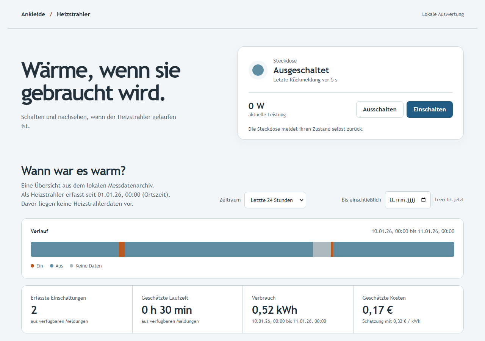

# Heater Dashboard

Ein kleines Dashboard für eine Tasmota-Steckdose: Schalten, Laufzeiten und Stromverbrauch auswerten und den Lichtmodus für Home Assistant einstellen. Die Oberfläche wird über einen eigenen Server bereitgestellt; sie enthält keine MQTT- oder Datenbankzugangsdaten.



[Mobile Ansicht](docs/dashboard-mobile.png) · [Einstellungen im dunklen Design](docs/settings-dark.png)

*Die Screenshots zeigen ausschließlich synthetische Beispieldaten.*

## Funktionen

- Live-Status und einmaliges Schalten über MQTT; erneute Einschaltbefehle während einer ausstehenden Bestätigung werden unterbunden.
- Zustandshistorie mit markierten Datenlücken, geschätzter Laufzeit, Zählerstand und Kosten auf Basis eines selbst eingetragenen Strompreises. Es gibt keine automatische Tarifhistorie.
- Zeitraum von 1, 7, 30 oder 90 Tagen mit frei wählbarem Enddatum; ältere Daten müssen im Archiv vorhanden sein.
- Home-Assistant-Lichtautomatik: Schalter für Ganztagsbetrieb oder Nachtbetrieb von 21–7 Uhr. Das Licht ist die Zustandsquelle; das Ausschalten des Lichts schaltet die Steckdose aus. Die Automation muss separat in Home Assistant eingerichtet werden.
- Optionaler Recorder schreibt vollständige STATE- und SENSOR-Meldungen in eine TimescaleDB-Tabelle. Die Webauswertung liest das vorhandene Archiv; sie liest nicht direkt die Recorder-Rohtabelle.

## Vor dem Betrieb

**Die Anwendung authentifiziert Benutzer nicht.** Nur hinter einem korrekt konfigurierten, eingeschränkten VPN bzw. authentifizierten Reverse-Proxy mit TLS betreiben. DNS und ein geheimer Link sind keine Zugriffskontrolle. MQTT-Zugriff auf die nötigen Topics und den Datenbankbenutzer auf lesende Rechte begrenzen. Die tatsächlich eingesetzte Broker-ACL, Netztrennung und TLS-Zertifikatsprüfung separat überprüfen.

Eine geräteseitige, unabhängig funktionierende Abschaltung ist Voraussetzung: Tasmota-PulseTime und ein eigener Watchdog müssen passend eingerichtet und einschließlich Wiederholung von ON und Stromwiederkehr am tatsächlichen Gerät getestet werden. Diese Software richtet das nicht automatisch ein und kann eine sichere Gerätefunktion nicht garantieren. Die Laufzeit ist auf der Webseite nicht verstellbar.

## Einrichtung

Benötigt werden Python 3.11+, ein MQTT-Broker, eine PostgreSQL-/TimescaleDB-Datenbank mit kompatiblem MQTT-Archiv und optional Home Assistant. Konfiguration über Umgebungsvariablen; Passwörter ausschließlich in geschützten Laufzeitumgebungen speichern.

```sh
python -m venv .venv
. .venv/bin/activate
pip install -r requirements.txt
export HEATER_MQTT_BASE=home/heater
export HEATER_MQTT_HOST=mqtt.example.internal
export HEATER_MQTT_USER=heater_dashboard
# Set HEATER_MQTT_PASSWORD and HEATER_PG_DSN through a protected runtime secret store.
export HEATER_HISTORY_START='2025-01-01T00:00:00Z'
export HEATER_ALLOWED_HOSTS='localhost,127.0.0.1'
export HEATER_PUBLIC_ORIGIN='http://localhost:8091'
uvicorn app:app --host 127.0.0.1 --port 8091
```

`HEATER_HISTORY_BASES` kann mehrere komma-separierte Basis-Topics desselben Geräts zusammenführen. `HEATER_DATA_DIR` legt den persistenten Speicherort der lokalen Preiseinstellung fest. Die Anwendung erwartet bestehende Tabellen `samples(ts, topic, field, value)` und `events(ts, topic, payload)` und einen kompatiblen Archiver, der diese befüllt; der optionale Rohdaten-Recorder allein befüllt diese Tabellen nicht. Der Zeitstempel `HEATER_HISTORY_START` verhindert die Zuordnung älterer Gerätenutzung.

Für den Lichtmodus verwendet die Seite `<HEATER_MQTT_BASE>/config/ganztags` mit den retained Payloads `ON` und `OFF`. Ein MQTT-Binärsensor in Home Assistant muss dieses Topic abonnieren. Zum Initialisieren `ON` oder `OFF` mit `retain: true` auf dieses Topic veröffentlichen; ohne gültigen Zustand bleibt die automatische Einschaltung gesperrt. Die Automation prüft `ON` als ganztägig und bei `OFF` das Fenster 21–7 Uhr; bei unbekanntem Sensorzustand darf sie nicht automatisch einschalten. Die Beispielkonfiguration unter `examples/` muss an die eigenen Entity- und Topic-Namen angepasst werden. Nach jeder Änderung die Kette mit Test-Entities prüfen, bevor ein angeschlossenes Gerät geschaltet wird.

## Entwicklung

```sh
python -m unittest discover -s tests -v
node --check static/app.js
```

Der Recorder und seine Tests liegen in `recorder/`. Vor öffentlichen Screenshots: echte Zustände, Tarife, Adressen und Nutzungsverläufe durch Beispieldaten ersetzen. Die bereitgestellten Bilder wurden mit einer isolierten Demo-Antwort erzeugt.
